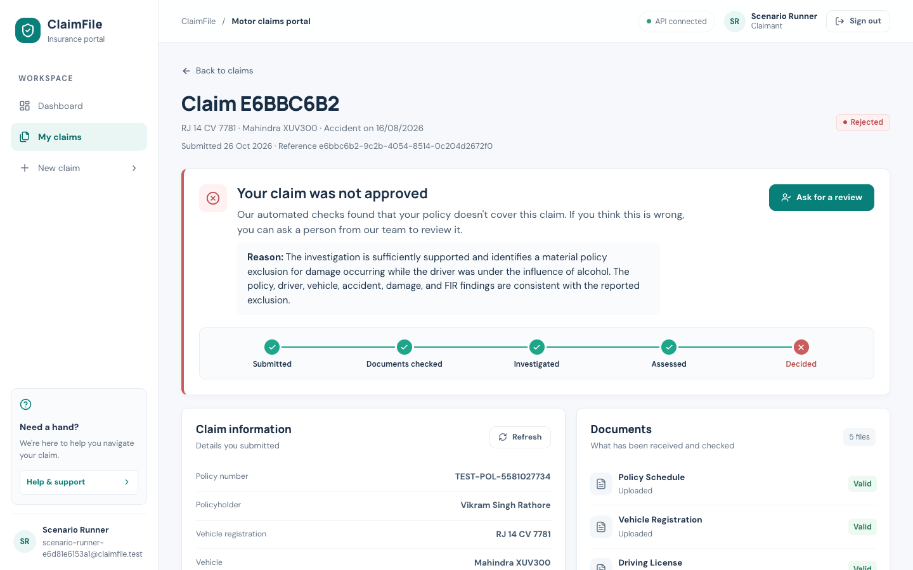
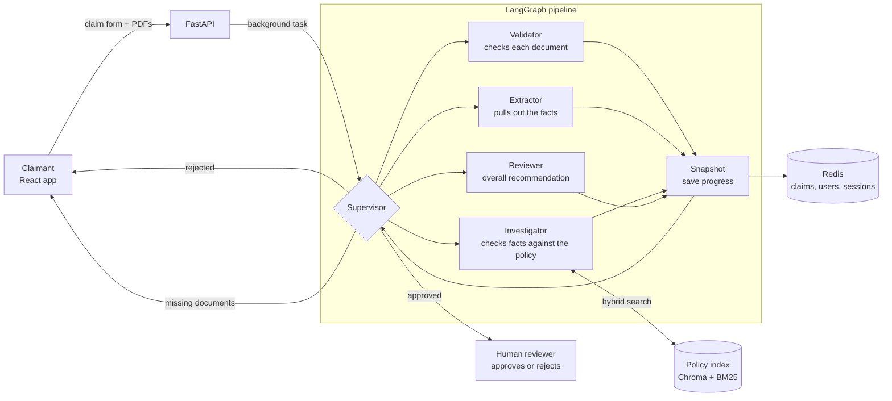
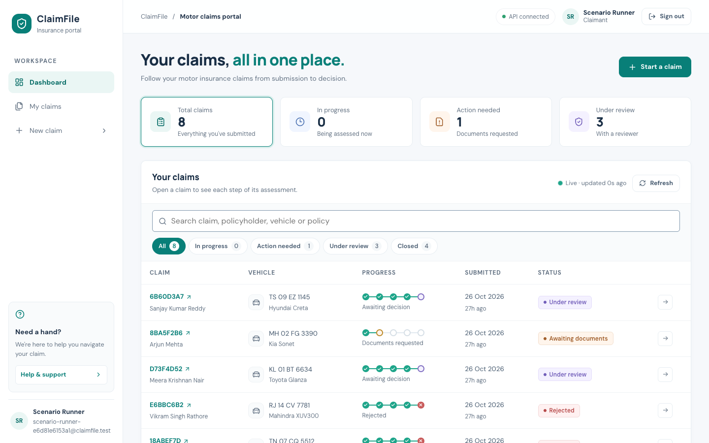
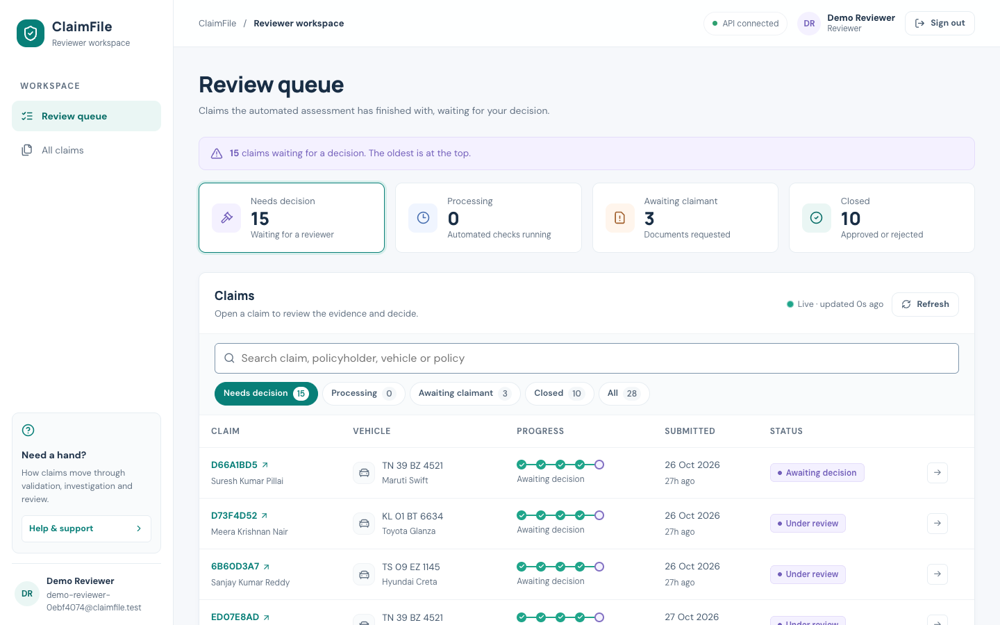
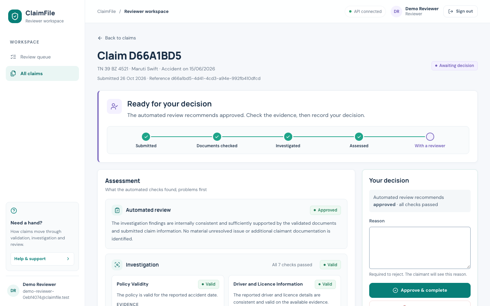
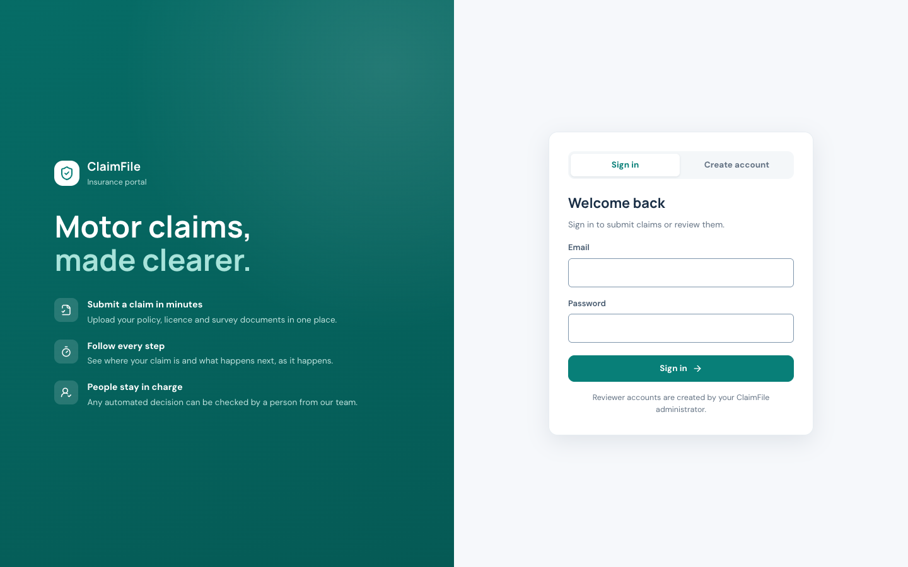
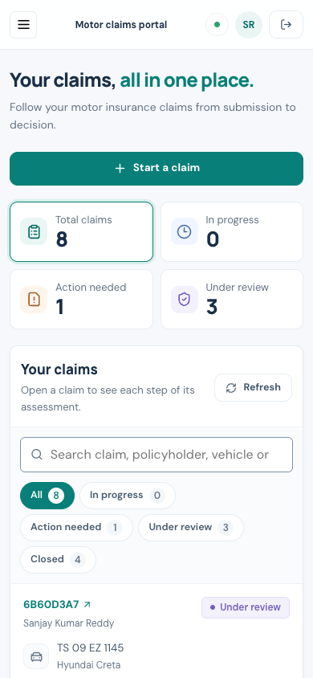

# ClaimFile

Motor insurance claim processing. Claimants submit a claim with supporting
documents; a LangGraph pipeline of agents validates the documents, extracts
the facts, investigates them against the policy wording (RAG over the policy
PDFs) and reviews the result. A human reviewer makes the final decision.

- **Backend:** FastAPI, LangGraph, OpenAI, Chroma + BM25 retrieval, Redis
- **Frontend:** React + Vite (`frontend/`)



## How it works



1. A claimant submits the claim form and five documents: policy schedule,
   vehicle registration, driving licence, damage survey report and repair
   estimate.
2. A **supervisor** decides which agent runs next. After every step, the
   claim's state is saved to Redis, so the UI shows progress live and a
   failed run can be retried.
3. The **validator** checks each document, the **extractor** turns them into
   structured facts, the **investigator** compares those facts with the policy
   wording (retrieved from the policy PDFs with vector + keyword search), and
   the **reviewer** combines the findings into a recommendation.
4. The outcome decides what happens next:
   - **Approved** claims wait for a human reviewer, who makes the final call.
   - **Rejected** claims (for example, a documented exclusion such as drunk
     driving) are closed automatically, and the claimant can ask a person to
     review them.
   - **Needs more evidence** claims ask the claimant for documents, or go to
     internal review.
5. Each claim has a step, token and cost budget, so a run can never loop or
   spend without limit.

## Screenshots

| Claimant dashboard | Reviewer queue |
|---|---|
|  |  |
| **Reviewer decision page** | **Sign in** |
|  |  |



The layout adapts to phones: claims become cards and buttons stack.

## Where data lives

| Store | What it holds |
|---|---|
| Redis | Claims, per-step snapshots, users, sessions, and sorted-set indexes for dashboard filtering and pagination |
| Chroma (`data/policy_index/`) | Policy wording as embeddings, for meaning-based search |
| BM25 (`data/policy_bm25/`) | The same wording as a keyword index, for exact terms and clause names |

## Run locally

Requirements: Python, Node and Docker (tested with Python 3.14 and Node 26).

```bash
# 1. Redis
docker compose up -d

# 2. Backend
python -m venv venv
venv/bin/pip install -r requirements.txt
cp .env.example .env                    # then fill in OPENAI_API_KEY
venv/bin/python -m scripts.build_index  # once: index the policy PDFs
venv/bin/uvicorn app.main:app --port 8000 --env-file .env

# 3. Frontend (separate terminal)
cd frontend
npm install
npm run dev                             # http://localhost:5173
```

The frontend calls the API through Vite's `/api` proxy, so the session cookie
is same-origin. Open the app on `http://localhost:5173`.

`--env-file .env` lets uvicorn read `FORWARDED_ALLOW_IPS` (below); the API
logs a warning at startup when it is missing. Behind a reverse proxy, set it to
the proxy's address as uvicorn sees it (e.g. the Docker gateway), and make the
proxy set or append `X-Forwarded-For` (nginx: `$proxy_add_x_forwarded_for`).

Rebuilding the policy index never leaves a half-built index: it builds a
staging copy and only swaps it in once the whole build has succeeded. Claims
processed during the brief swap itself may miss policy evidence, so rebuild
when no claims are processing.

## Accounts

- **Claimants** create their own account on the sign-in page, then sign in.
  Sign-up gives the same answer whether or not the email already has an
  account, so it cannot be used to check who is registered. They see only
  their own claims.
- **Reviewers** see every claim and approve or reject the ones awaiting human
  review. They cannot sign up through the app; create one with:

  ```bash
  venv/bin/python -m scripts.create_reviewer
  ```

## Environment variables

Backend (`.env`, see `.env.example`):

| Name | Purpose |
|---|---|
| `OPENAI_API_KEY` | OpenAI key used by all agents (required) |
| `OPENAI_MODEL` | Model name |
| `MAX_STEPS`, `MAX_TOKENS`, `MAX_COST` | Per-claim processing budget |
| `COOKIE_SECURE` | HTTPS-only session cookie. Defaults to `true`; set `false` only if your local browser drops it over http (Safari) |
| `ALLOWED_ORIGINS` | Comma-separated browser origins allowed to call the API |
| `FORWARDED_ALLOW_IPS` | Reverse-proxy IPs whose `X-Forwarded-For` uvicorn trusts for the client IP (login rate limits). Empty = none. Set it to your proxy's IP in deployment |

Frontend (`frontend/.env`, see `frontend/.env.example`):

| Name | Purpose |
|---|---|
| `VITE_API_BASE_URL` | API base path; keep `/api` in development |

## Tests

```bash
# Fast, no LLM calls (needs Redis)
venv/bin/python -m pytest tests/test_auth_api.py tests/test_human_gate.py tests/test_investigator_status.py tests/test_build_index.py -q

# Policy retrieval checks
venv/bin/python -m tests.eval_policy_retrieval

# 8 end-to-end scenario claims against the running API (uses the LLM)
venv/bin/python -m scripts.make_test_claims
venv/bin/python -m tests.run_test_claims
```

`venv/bin/python -m utils.clear_redis` deletes all claims (asks first).
